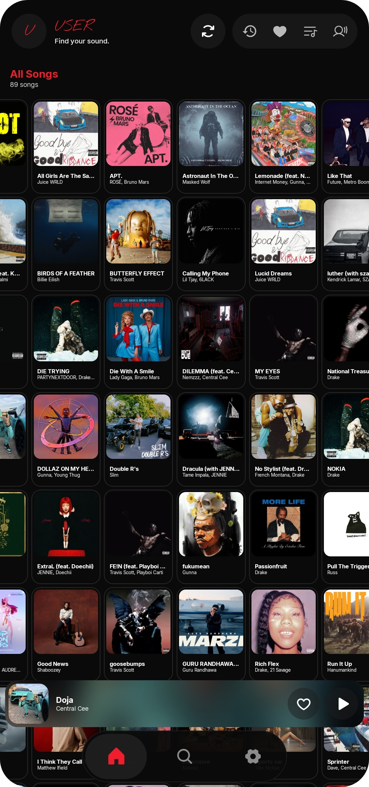
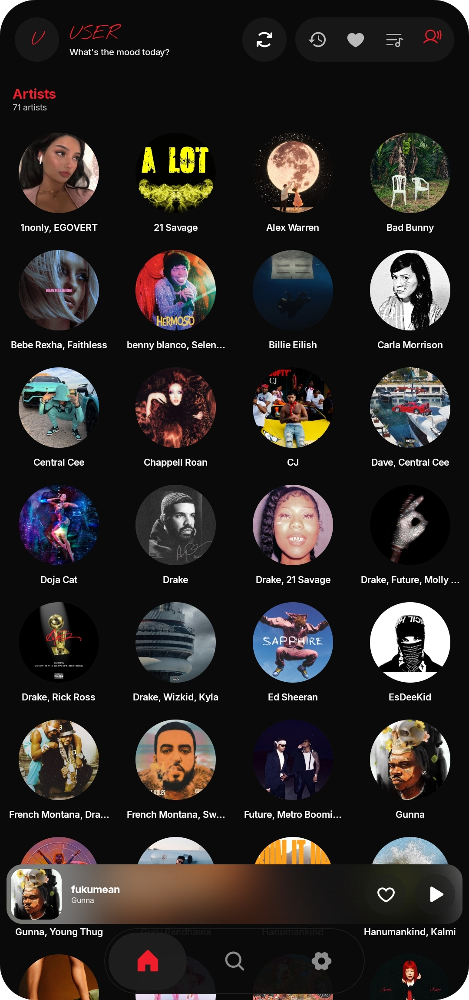
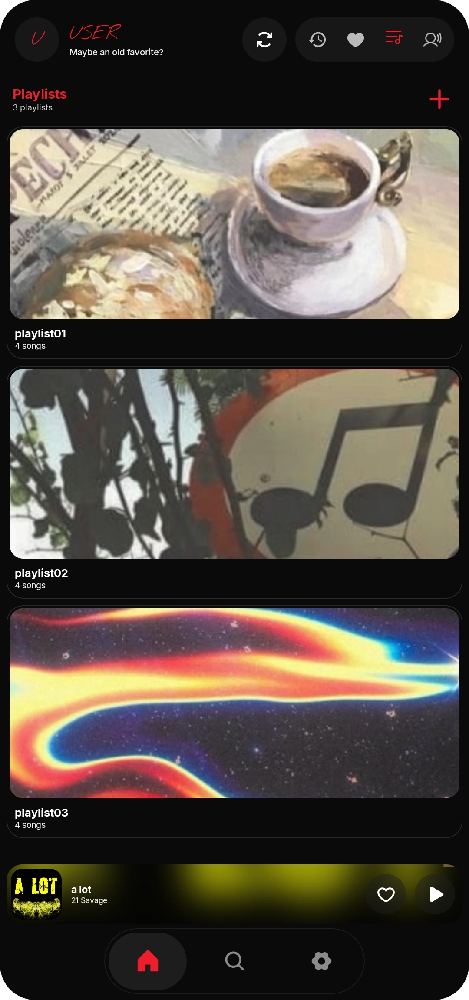
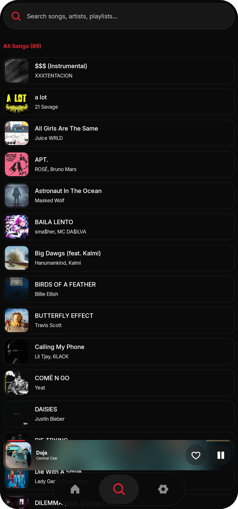
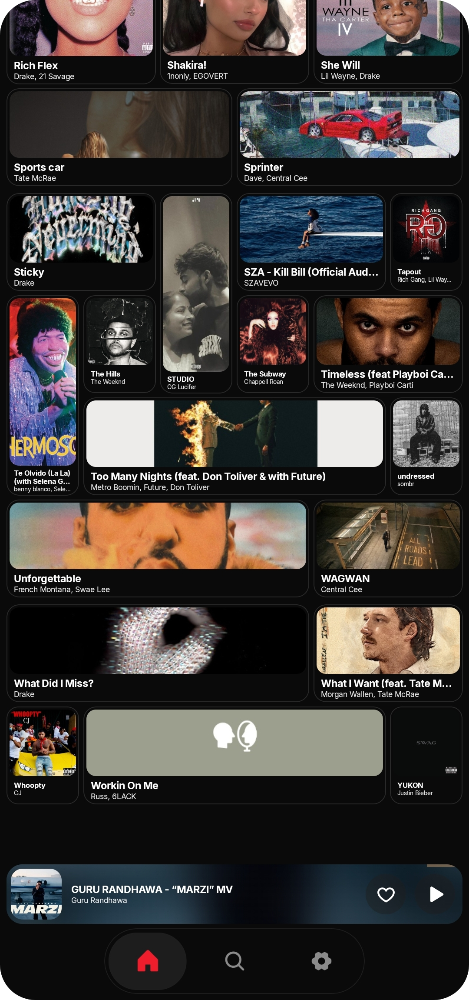
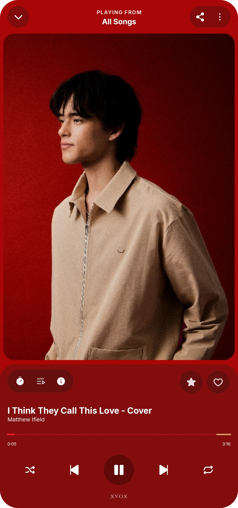

# XVOX

**Your Music. Your Experience.**

A premium offline music player for Android.

---

## About XVOX

XVOX is an offline music player built around immersive artwork, smooth playback, and a refined interface. Enjoy your personal music library with intuitive controls and extensive customization, without depending on music streaming services.

## Features

- **Music Library** — Browse and search your local music.
- **Now Playing** — Immersive artwork, playback controls, queue management, and lyrics.
- **Mini Player** — Keep playback within reach while navigating the app.
- **Playlists & Favorites** — Create playlists, like tracks, and revisit recently played music.
- **Personalization** — Customize themes, colors, typography, layouts, and navigation.
- **Audio Controls** — Equalizer, crossfade, and supported sound enhancements.
- **Home Screen Widget** — Control playback directly from your home screen.
- **Background Playback** — Keep listening while using other apps.
- **Dynamic Artwork** — Track-specific cover art and palette-aware visuals.

## Screenshots

| Home | Artist | Playlist |
|:---:|:---:|:---:|
|  |  |  |

| Search | Mini Player | Now Playing |
|:---:|:---:|:---:|
|  |  |  |

And more.

## Release

**Latest Version:** `v1.01.01`

[Download XVOX](../../releases/tag/v1.01.01)

Choose the APK that fits your device:

| File | Recommended for |
|---|---|
| `XVOX-v1.01.01-arm64-v8a.apk` | Most current Android phones and tablets |
| `XVOX-v1.01.01-armeabi-v7a.apk` | Older 32-bit ARM devices |
| `XVOX-v1.01.01-x86_64.apk` | x86_64 emulators and compatible ChromeOS devices |
| `XVOX-v1.01.01-universal.apk` | Any supported device when the ABI is unknown |

Each APK has a same-named `.idsig` sidecar for APK Signature Scheme v4, plus `SHA256SUMS.txt` for integrity checks. If you are unsure which ABI your phone uses, download the **universal** APK.

## License

**All Rights Reserved**

Copyright © 2026 lxzrvi.

This repository is available for viewing and inspection only. Copying, modifying, distributing, or reusing any part of this software without prior written permission from the copyright holder is prohibited.

See [LICENSE](LICENSE) for details.
